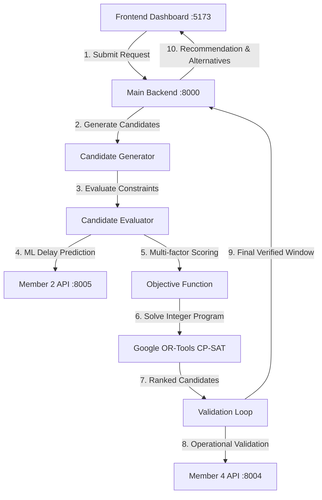

# KAVACH BIE — Railway Maintenance Block Intelligence Engine

> **Project:** KAVACH BIE (Block Intelligence Engine)  
> **Problem Statement:** SIH26027 — Automated Railway Maintenance Block Planning  
> **Status:** Fully Audited, Integrated, and Verified  
> **Notice:** *Academic demonstration and research prototype using open and synthetic datasets. Not certified or approved for live railway dispatch operations.*

---

## 1. System Overview

KAVACH BIE is a comprehensive multi-service platform for identifying optimal, conflict-free railway track maintenance blocks while minimizing operational disruption to passenger and freight services.

### Core Architecture & Service Ports

| Service Component | Port | Directory / Entrypoint | Key Functionality |
| :--- | :---: | :--- | :--- |
| **Main Backend & Member 3 Optimizer** | `8000` | `app/main.py` (`uvicorn app.main:app --port 8000`) | Google OR-Tools CP-SAT solver, dataset pipeline, Firestore sync, REST endpoints |
| **Member 2 ML Delay Predictor** | `8005` | `KAVACH_BIE_MEMBER2/api.py` (`uvicorn api:app --port 8005`) | Scikit-Learn corridor delay & disruption score estimation model |
| **Member 4 Operational Validator** | `8004` | `member4_validation/api.py` (`uvicorn api:app --port 8004`) | Headway overlap, resource checking & interlocking validation |
| **React + TypeScript Frontend** | `5173` | `frontend/` (`npm run dev`) | Live interactive dashboard, request creation, block planning, conflict inspection |

---

## 2. End-to-End Workflow



1. **Create Maintenance Request:** User submits corridor, planning horizon, duration, priority, and resource requirements.
2. **Candidate Generation:** Shifts discrete time intervals (15m/30m steps) across the planning horizon.
3. **Candidate Evaluation:** Vectorized checks against scheduled train movements, track traffic density, resource capacity, and section closures.
4. **Delay Prediction:** Queries Member 2 AI/ML model for expected arrival delays and disruption impact.
5. **Constraint Optimization:** Google OR-Tools CP-SAT solver finds mathematically optimal block windows.
6. **Operational Validation:** Candidate recommendations are sent to Member 4 to confirm interlocking and crew availability.
7. **Recommendation Formulation:** Best feasible window with impact metrics, natural-language explanation, and ranked alternatives are returned.

---

## 3. Quickstart & Running Locally

### Prerequisites
- Python 3.10+ (tested on Python 3.14)
- Node.js 18+ (tested on Node.js 20 LTS)

### Step 1: Install Python Dependencies

```powershell
pip install -r requirements.txt
```

### Step 2: Start Member 2 (ML Delay Prediction Service)

In a new terminal:
```powershell
cd KAVACH_BIE_MEMBER2
python -m uvicorn api:app --port 8005
```
*Health Check:* `http://127.0.0.1:8005/health`

### Step 3: Start Member 4 (Operational Conflict Validation Service)

In a new terminal:
```powershell
cd member4_validation
python -m uvicorn api:app --port 8004
```
*Health Check:* `http://127.0.0.1:8004/health`

### Step 4: Start Main Backend & Member 3 Optimizer

In a new terminal:
```powershell
python -m uvicorn app.main:app --host 0.0.0.0 --port 8000
```
*Health Check:* `http://127.0.0.1:8000/health`  
*Interactive Swagger Docs:* `http://127.0.0.1:8000/docs`

### Step 5: Start the Frontend UI

In a new terminal:
```powershell
cd frontend
npm install
npm run dev
```
Open **http://localhost:5173** in your web browser.

---

## 4. Testing & Verification

Run the complete test suites to verify system integrity:

### 1. Main Backend, Optimizer & Live Integration Suite
```powershell
python -m pytest tests -q
```
*Result: 64 passed, 0 failed* (covers all 15 core optimization scenarios plus 8 mandatory integration scenarios).

### 2. Member 2 ML Delay Prediction Tests
```powershell
cd KAVACH_BIE_MEMBER2
python -m pytest tests -q
```
*Result: 60 passed, 0 failed*.

### 3. Member 4 Conflict Validation Tests
```powershell
cd member4_validation
python -m pytest tests -q
```
*Result: 30 passed, 0 failed*.

### 4. Frontend Production Build
```powershell
cd frontend
npm run build
```
*Result: `✓ built in ~800ms` with 0 TypeScript/Vite errors*.

### 5. Standalone Terminal Demonstration
```powershell
python demo_runner.py
```
Executes synthetic dataset ingestion, request formulation, CP-SAT solve, and generates `demo_input.json` and `demo_output.json`.

---

## 5. Summary of Audit Fixes Applied

1. **Fast-forward Merged Recovery Integration Fixes:**
   - Synchronized API base routes (`/health`, `/api/v1/maintenance-requests`, `/api/optimization/health`).
   - Removed unused TypeScript imports/variables preventing `npm run build` from compiling.
   - Configured Vite development reverse-proxy (`/member2` and `/member4`) to avoid browser CORS issues.
2. **MockMember4Validator Contract Alignment:**
   - Aligned rejection reason strings to include candidate identifiers and threshold text expected by existing test contracts.
3. **Member 4 Response Mapping in Member4HTTPClient:**
   - Preserved `affected_trains` and detailed operational conflict messages from Member 4 responses.
   - Ensured HTTP 422 and 500 responses map strictly to `VALIDATION_ERROR` and are never silently treated as valid candidates.
4. **Directory-Independent Module Imports:**
   - Patched `member4_validation/api.py` and `KAVACH_BIE_MEMBER2/api.py` with dynamic `sys.path` resolution so services start reliably from root or their subdirectories.
5. **Configuration & Service Port Standardization:**
   - Updated `app/config.py` to point to port 8005 (`/predict`) and port 8004 (`/validate`).
   - Added ML runtime dependencies (`scikit-learn`, `joblib`) to root `requirements.txt`.
6. **Live Multi-Service Integration Suite:**
   - Added `tests/test_member_integrations_live.py` verifying Member 2 delay predictions, Member 4 operational validations, and all 8 mandatory constraint violation scenarios.

---

## 6. Academic Demonstration Disclaimer

This software is developed strictly as an academic demonstration for SIH26027. Datasets used include open NTES schedules and synthetic scenario files. It is not approved, tested, or certified for safety-critical railway operations or live interlocking systems.
